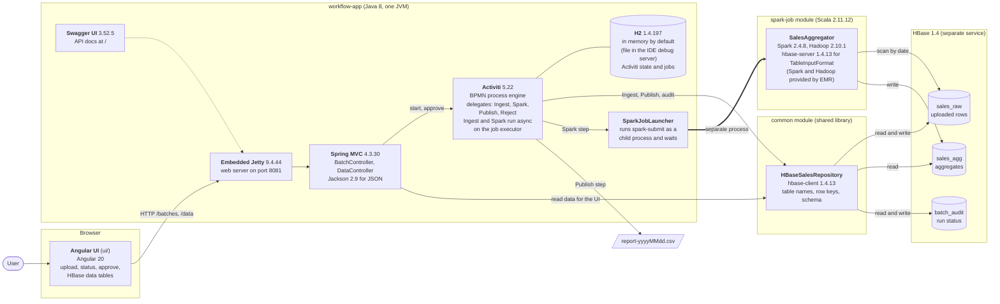
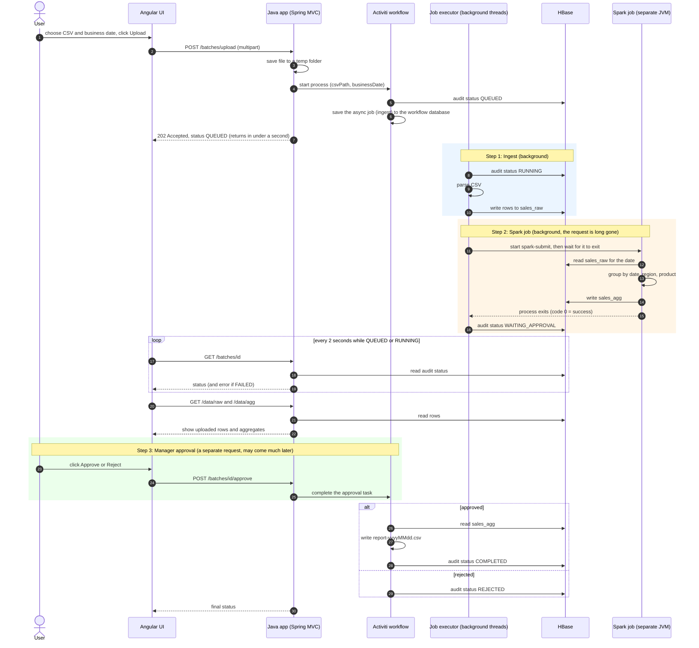
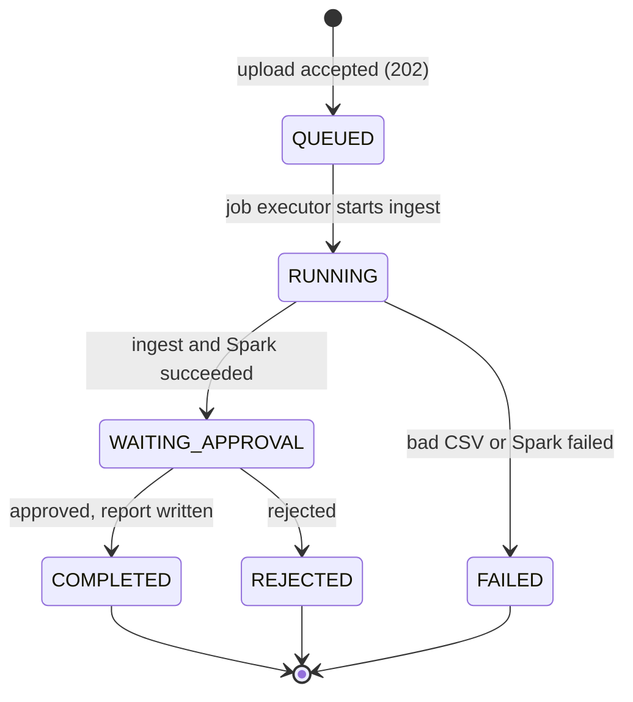

# Sales Batch: Architecture and Flow

> **The most complete and current description is [latest-ARCHITECTURE.md](latest-ARCHITECTURE.md)** (asynchronous runs, Postgres, the Docker Spark cluster, the VS Code debug setup, and the Metals and Bloop toolchain for Scala debugging). This document stays as the shorter introduction.

A small workflow application that loads a sales CSV into HBase, aggregates it with a Scala Spark job, waits for a manager's approval, and then publishes a report. It targets the EMR 5.36 stack (Java 8, Spark 2.4, Scala 2.11, HBase 1.4).

The diagrams below are written in [Mermaid](https://mermaid.js.org/). They render on GitHub, GitLab, and in VS Code (Markdown Preview Mermaid Support extension).

## 1. Components and dependencies

Each box shows the technology and its version. Arrows show who calls whom.

**Key point:** the Java app and the Spark job never talk to each other directly. They share data only through the HBase tables. The Java app starts Spark as a separate process (thick arrow) from a background thread of the workflow engine and waits for it to exit. The HTTP request that started the run has long returned by then.

## 2. Full flow of one run

The run is **asynchronous**: the upload request returns at once, and the Ingest and Spark steps run in the background (Activiti's job executor). The UI polls the status.

**If a background step fails** (a bad CSV line, or a non-zero Spark exit code), it does not throw. It stores the reason in `batch_audit`, sets the status to `FAILED`, and the process ends. Throwing would make the job executor retry a step that would only fail again. `GET /batches/{id}` then returns the status and the `error` text.

## 3. Workflow states

## 4. What each dependency is for

| Dependency | Module | Purpose |
|---|---|---|
| Spring MVC 4.3.30 | workflow-app | REST endpoints (upload, status, approve, data) |
| Activiti 5.22.0 | workflow-app | Runs the process: ingest, Spark, approval, publish or reject |
| H2 1.4.197 | workflow-app | Stores Activiti's own state and the pending background jobs. In memory by default (lost on restart); a file database in the IDE debug server |
| Jetty 9.4.44 | workflow-app | Embedded web server, so no Tomcat or WAR is needed |
| Jackson 2.9.10.8 | workflow-app | JSON for REST requests and responses |
| Swagger UI 3.52.5 (webjar) | workflow-app | API documentation page |
| logback 1.2.3, slf4j 1.7.30 | workflow-app | Logging |
| hbase-client 1.4.13 | common | Java client that reads and writes the HBase tables |
| `common` module | workflow-app, spark-job | Shared table names, row keys and schema |
| Spark 2.4.8 (spark-core) | spark-job | Distributed aggregation. `provided`: EMR supplies it |
| Hadoop 2.10.1 (hadoop-client) | spark-job | Spark's Hadoop APIs. `provided`: EMR supplies it |
| Scala 2.11.12 | spark-job | Language of the Spark job. `provided` |
| hbase-server 1.4.13 | spark-job | Gives Spark the HBase input format. Bundled into the Spark jar because EMR does not put HBase on Spark's classpath (Guava is relocated to avoid clashes) |
| Angular 20 | ui | Test UI that calls the REST API |
| HBase 1.4 | external service | Storage for raw rows, aggregates and run status |

## 5. Questions people ask

**Does Spark run inside the API session?**
No. It is a separate process (a child JVM locally, `spark-submit` on EMR). It reads the `sales_raw` table filtered by the business date and writes `sales_agg`. Nothing is passed between the two in memory.

**Does the upload request wait for Spark?**
No. `POST /batches/upload` returns `202 Accepted` with status `QUEUED` in well under a second. Ingest and the Spark step are marked `activiti:async` in the BPMN and run on Activiti's job executor threads (enabled in `EngineConfig`). The UI polls `GET /batches/{id}` every 2 seconds. The launcher still blocks, but only a background thread, not a web request.

**Is this how it is done with millions of rows?**
Not as is. A production version usually:
- returns immediately with a job ID (`202 Accepted`) and lets the UI poll the status (**this app already does this**);
- puts large files in S3 or HDFS and lets Spark read them directly, so the Java app never parses the rows;
- submits Spark to the cluster through a scheduler or job service (EMR Steps, Livy, Airflow, Step Functions) instead of a child process of the API;
- keeps workflow state in a real database such as Postgres or MySQL, so runs survive restarts.

The overall shape stays the same: ingest, aggregate, approve, publish, with Spark and the API sharing storage and not talking directly. The full design, with diagrams and a step-by-step description, is in [Large-App-ARCHITECTURE.md](Large-App-ARCHITECTURE.md).

## 6. Known limitations of this dummy app

- Activiti state is in memory by default, so a restart loses runs. The IDE debug server stores it in `./data/activiti` (H2 file), so a run waiting for approval survives a restart. For real use, point `-Dactiviti.jdbc.url` at Postgres or MySQL (needs the driver on the classpath).
- The background steps run in the same JVM as the API. This is asynchronous, not production-distributed: ingest still parses the CSV in Java. Spark runs as a child JVM (`local[*]`) by default, or optionally on a small standalone cluster in Docker (1 master, 2 workers, `-Dspark.mode=docker-cluster`) to exercise real executor processes. Workflow state can live in Postgres (`-Dactiviti.jdbc.url=...`). See [Large-App-ARCHITECTURE.md](Large-App-ARCHITECTURE.md) for the distributed design.
- Raw rows stay in HBase after a run. Use a new business date for each test.
- Behaviour on YARN or EMR has not been tested; local runs use Spark in `local[*]` mode.

See [README.md](README.md) for how to build, run and debug it locally.
