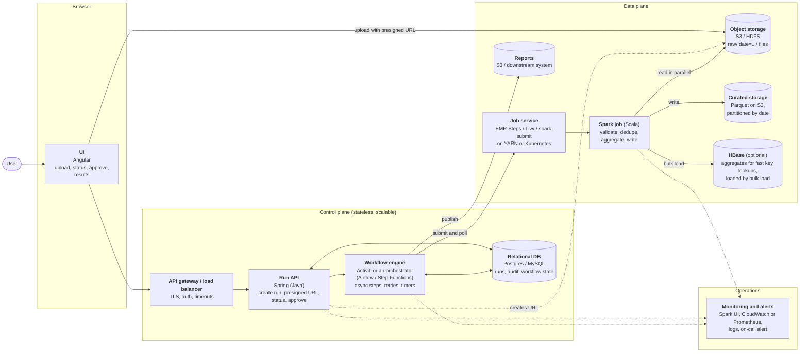
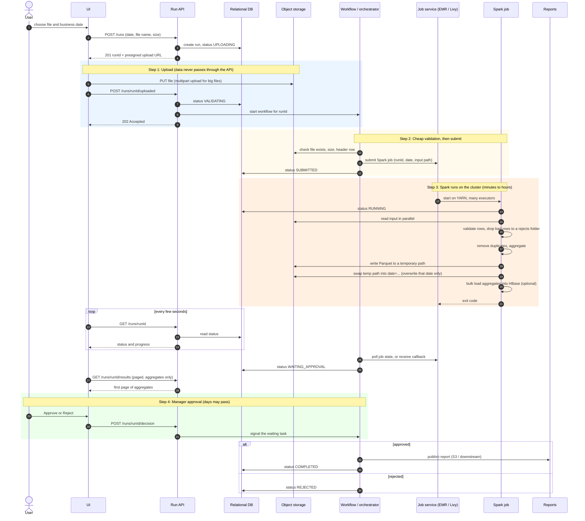
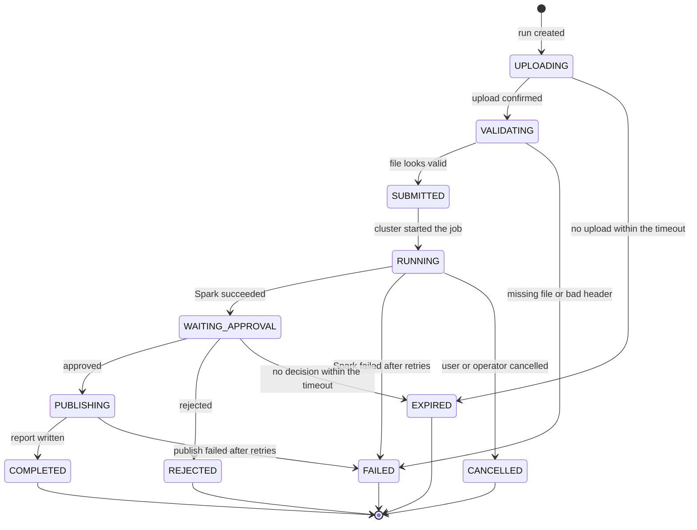

# Sales Batch at Scale: Reference Architecture for Large Datasets

This document describes how the Sales Batch pipeline should be built when the input is large (millions to billions of rows, files of many gigabytes). It is a **reference design**: it is not implemented in this repository. The current dummy app is described in [ARCHITECTURE.md](ARCHITECTURE.md), and section 11 below shows what has to change to get from that app to this design.

The diagrams are written in [Mermaid](https://mermaid.js.org/). They render on GitHub, GitLab, and in VS Code (Markdown Preview Mermaid Support extension).

Technology names are indicative. Pick the equivalent on your platform (for example Airflow or Step Functions as the orchestrator, S3 or HDFS as storage). Sizes mentioned are planning assumptions, not measurements.

## 1. Why the small app does not scale

| In the small app | Problem with large data |
|---|---|
| The browser uploads the file through the API | The API becomes the bottleneck. Large uploads hit HTTP timeouts and memory limits |
| The Java app parses the CSV and writes rows to HBase one by one | A single thread parsing billions of rows takes hours. HBase region servers get overloaded by individual `Put` calls |
| `POST /batches` blocks until Spark finishes | Browsers, proxies and load balancers time out after 30 to 120 seconds, while the job may run for hours |
| Spark runs as a child process of the API | It competes for CPU and memory with the API, cannot use a cluster, and is killed if the API restarts |
| Workflow state is in memory (H2) | A restart loses every running or waiting run |
| One file, one date, no retries | Real systems see failures, duplicates, reruns and late data every day |

## 2. Design principles

1. **The API is thin and fast.** It never touches the data. It only creates runs, hands out upload links, and reports status.
2. **Data moves directly between storage and the cluster.** Files go browser to S3 (or HDFS), and Spark reads them from there.
3. **Everything long-running is asynchronous.** A request returns immediately with a run ID, and the UI polls.
4. **State is durable.** Run state lives in a real database, so restarts, retries and audits are safe.
5. **Every step can be repeated safely (idempotent).** Rerunning a date overwrites its own result and never duplicates it.
6. **Observe everything.** Each run has a status, logs, metrics and an owner to alert.

## 3. Components and dependencies



**Key point:** the control plane (API, workflow, database) only moves small messages and statuses. The data plane (storage, Spark) moves the big data. The two never mix.

## 4. Full flow of one run



## 5. Run states



## 6. How each step works

### Step 1: Create the run and upload the file

- **What happens:** the UI asks the API to create a run and gets back a run ID and a time-limited, pre-signed upload URL. The browser uploads the file straight to object storage. Large files use multipart upload, which can resume after a network failure.
- **Why:** the API never carries the file, so it stays small and fast and cannot be knocked over by a big upload.
- **Rules to follow:**
  - Store files under `raw/business_date=YYYYMMDD/run_id=<id>/` so each run has its own folder.
  - Limit file size and accepted types in the pre-signed URL conditions.
  - Expire runs that never complete the upload, so they do not stay `UPLOADING` forever.
  - Authorize the user before issuing the URL.

### Step 2: Validate cheaply, then submit

- **What happens:** the workflow checks only what is cheap: the file exists, its size is plausible, and the header row matches the expected columns. It then submits the Spark job to the cluster and records the status `SUBMITTED`.
- **Why:** fail fast on obvious problems without starting an expensive cluster job. Do **not** read the whole file in the workflow.
- **Rules to follow:** pass the run ID, business date and input path to Spark as arguments. Make the submission itself safe to retry (the same run ID cannot start two jobs).

### Step 3: Spark processes the data on the cluster

- **What happens:** the job runs on YARN (or Kubernetes) with many executors and does the heavy work:
  1. **Read** the CSV in parallel with an explicit schema (no schema inference on huge files). Prefer converting to Parquet early.
  2. **Validate** each row (types, required fields, sane values). Write bad rows to a `rejects/` folder with a reason, and count them. Fail the run only if the reject rate is above a threshold.
  3. **Remove duplicates** by a business key (for example `orderId`), so a re-sent file does not double count.
  4. **Aggregate** by date, region and product with `reduceByKey` or DataFrame `groupBy`.
  5. **Write** the result to a temporary path first, then swap it into `date=YYYYMMDD` so readers never see half-written data.
  6. **Load** the aggregates into HBase using bulk load (see section 7), if fast key lookups are needed.
- **Why:** the cluster scales out with the data. The API is not involved.
- **Rules to follow:**
  - Never use the driver to collect the full dataset (`collect()` on large data crashes it).
  - Control the number of partitions (a common starting point is 2 to 4 times the number of cores, then tune with the Spark UI).
  - Report progress and the final counts (rows read, rows rejected, rows written) to the run record.

### Step 4: Track the job without blocking

- **What happens:** the workflow does not wait inside a thread. It either polls the job service on a timer or receives a callback, and updates the run status.
- **Why:** a blocked thread per running job does not scale and is lost on restart. State in the database means a restarted workflow resumes where it left off.
- **Rules to follow:** set a maximum run time and cancel the job if it is exceeded. Retry transient failures (for example a lost node) a limited number of times, but do not retry a validation failure.

### Step 5: Show results

- **What happens:** the UI reads **aggregates only**, paged, from the curated store or HBase. Raw rows are never returned through the API.
- **Why:** with billions of raw rows, "show the uploaded data" has to become "show a sample, counts and the aggregates".
- **Rules to follow:** always page results, cap page size, and filter by business date.

### Step 6: Approve

- **What happens:** the workflow waits at a human task. The approval can take hours or days, so it must be a durable wait (a stored task), not an open request.
- **Rules to follow:** record who approved and when. Add a timeout that moves the run to `EXPIRED`, and show approvers the aggregates and the reject counts, not just a button.

### Step 7: Publish

- **What happens:** the workflow writes the report to S3 or sends it downstream, then sets `COMPLETED`.
- **Rules to follow:** publish to a new versioned path, and write a small "ready" marker file last. Consumers read only paths that have a marker.

## 7. Data layout and HBase

**Object storage layout**

```
s3://sales-batch/
  raw/      business_date=20261115/run_id=<id>/file.csv     (immutable input, kept by policy)
  rejects/  business_date=20261115/run_id=<id>/part-*       (bad rows with a reason)
  curated/  business_date=20261115/part-*.parquet            (aggregates, overwritten per date)
  reports/  business_date=20261115/run_id=<id>/report.csv + _READY
```

**If HBase is used for aggregates**

| Topic | Recommendation |
|---|---|
| Row key | Keep a salted, date-prefixed key, as in the small app (`<salt>_<date>_<id>`), so writes spread across regions and one date is easy to scan |
| Writes | Use **bulk load**: Spark writes HFiles, and HBase adopts them in one step. Plain `Put` calls for millions of rows overload region servers |
| Pre-splitting | Create tables with split points matching the salt buckets, so load does not start on a single region |
| What to store | Aggregates and lookup data. Avoid keeping billions of raw rows in HBase; raw data belongs in S3 |
| Reruns | Overwrite by date: delete or replace that date's rows before loading, so a rerun does not leave old values |

## 8. Orchestration options

| Option | How it works | Good when |
|---|---|---|
| **EMR Steps** | The API or workflow calls the EMR API to add a Spark step to a cluster | You already run EMR and want the simplest path |
| **Apache Livy** | A REST service in front of Spark; submit batch jobs, poll their state | You want a plain HTTP interface to an existing cluster |
| **Airflow / Step Functions** | A DAG or state machine owns the whole run: validate, submit, wait, approve, publish | You want retries, timers, history and a UI for operators for free |
| **Activiti (keep it)** | The Spark step is async and only submits. A timer polls until done | You already have BPMN processes and want to evolve step by step. Needs a real database |

Whatever you choose: **submit, then wait by polling or callback.** Do not hold a worker thread for the duration of the job.

## 9. Reliability rules (the "must follow" list)

1. **Idempotent runs.** Rerunning a business date overwrites its own output and cannot duplicate or double count.
2. **Unique run IDs.** Every run, job submission and output path carries the run ID.
3. **Atomic output.** Write to a temporary location, then swap. Readers never see partial results.
4. **Durable state.** Workflow and run state in Postgres or MySQL with backups.
5. **Timeouts everywhere.** Upload expiry, job maximum run time, approval expiry.
6. **Bounded retries.** Retry transient errors with backoff. Never retry validation errors. Move exhausted runs to `FAILED` and alert.
7. **Dead-letter data.** Bad rows go to `rejects/` with a reason. They never silently disappear.
8. **Pagination and limits.** No API returns unbounded data.
9. **Backpressure.** Limit the number of runs started at once per cluster, and queue the rest.
10. **Schema discipline.** Keep an explicit schema and version it. Reject files that do not match it.

## 10. Security and operations

| Area | What to do |
|---|---|
| Authentication | Put the API behind an identity provider (OIDC or SSO). The UI sends a token with every call |
| Authorization | Only approvers can approve, and only owners see their runs. Check this in the API, not only in the UI |
| Data protection | Encrypt storage at rest, use TLS in transit, keep presigned URLs short-lived |
| Secrets | Keep credentials in a secret store, not in the code or properties files |
| Logging | One structured log line per step with the run ID, so a run can be traced across API, workflow and Spark |
| Metrics and alerts | Run duration, success rate, rows read, rows rejected, queue depth. Alert on `FAILED` and on runs stuck in one state |
| Cost | Use transient or autoscaling clusters, spot instances for executors, and S3 lifecycle rules to expire old raw files |
| Audit | Keep who uploaded, who approved, which file version, and when, for every run |

## 11. From the current app to this design

| Current dummy app | Large-data design | Effort |
|---|---|---|
| ~~`POST /batches/upload` blocks until Spark finishes~~ **Done in this app:** it returns `202 QUEUED` and the UI polls `GET /batches/{id}` | `POST /runs` returns `202` and a run ID; the UI polls `GET /runs/{id}` | Done (two BPMN attributes, one engine setting, failure routing, UI polling) |
| Activiti state in H2 in memory by default; **the IDE debug server already uses an H2 file** | Activiti on Postgres or MySQL | Small: the data source URL is now configurable (`activiti.jdbc.url`); add the driver |
| Java app parses the CSV and writes `sales_raw` | Spark reads the file directly from storage; the Java ingest step is removed | Medium: move parsing and validation into the Scala job |
| File uploaded through the API | Pre-signed URL upload to S3 or HDFS | Medium: new endpoint and a UI change |
| Spark started as a child process of the API | Submit to a cluster (EMR Step, Livy or an orchestrator) and poll | Medium: replace `ProcessSparkJobLauncher` |
| `Put` per row into HBase | Bulk load, or Parquet on S3 | Medium |
| UI shows all raw rows | UI shows counts, a sample and paged aggregates | Small |
| Report written to a local folder | Report written to S3 with a ready marker | Small |
| No retries, no idempotency | Section 9 rules | Medium |

**Suggested order**

1. ~~Make the Spark step asynchronous~~ (done in this app) and move Activiti to a real database (the URL is configurable now; Postgres or MySQL still needs its driver).
2. Let Spark read the file directly and remove the Java ingest.
3. Submit Spark to a cluster instead of a child process.
4. Add direct-to-S3 upload, bulk load and the reliability rules.
5. Add authentication, monitoring and cost controls before the first production run.

## 12. Dependencies for the large-data design

| Component | Example technology | Purpose |
|---|---|---|
| Run API | Spring (Java) | Creates runs, issues upload URLs, reports status, records approvals |
| Workflow or orchestrator | Activiti on a real database, Airflow, or Step Functions | Runs the steps asynchronously with retries, timers and human tasks |
| Relational database | Postgres or MySQL | Durable run state, audit trail, workflow state |
| Object storage | S3 or HDFS | Raw files, rejects, curated Parquet, reports |
| Job service | EMR Steps, Livy, or spark-submit on YARN or Kubernetes | Starts Spark jobs on the cluster and reports their state |
| Compute | Spark (Scala) on a cluster | Parallel validation, de-duplication and aggregation |
| Serving store (optional) | HBase with bulk load | Fast key lookups of aggregates |
| UI | Angular | Upload, status, results, approval |
| Identity provider | OIDC / SSO | Authentication and roles |
| Monitoring | Spark UI, CloudWatch or Prometheus, central logs | Visibility, alerts, troubleshooting |

## 13. Open decisions to settle with your team

- Expected size per run and per day (rows, gigabytes), and how fast results are needed.
- Whether aggregates must be served by key (then HBase) or only reported (then Parquet is enough).
- Which orchestrator and cluster platform your organization already runs.
- Retention rules for raw files, rejects and reports.
- Who approves, how long they have, and what happens if nobody decides.
