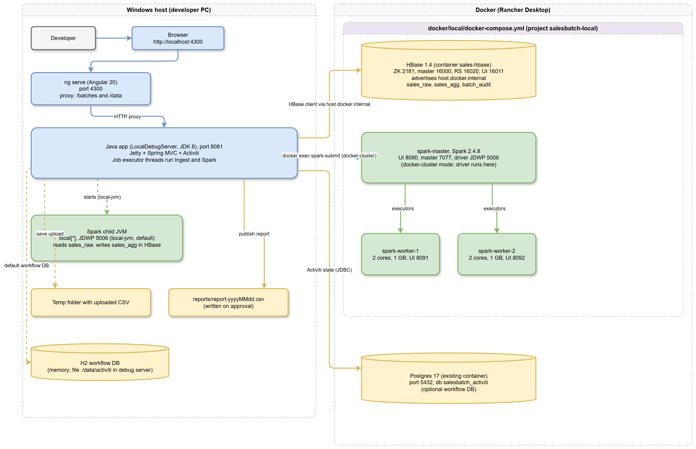
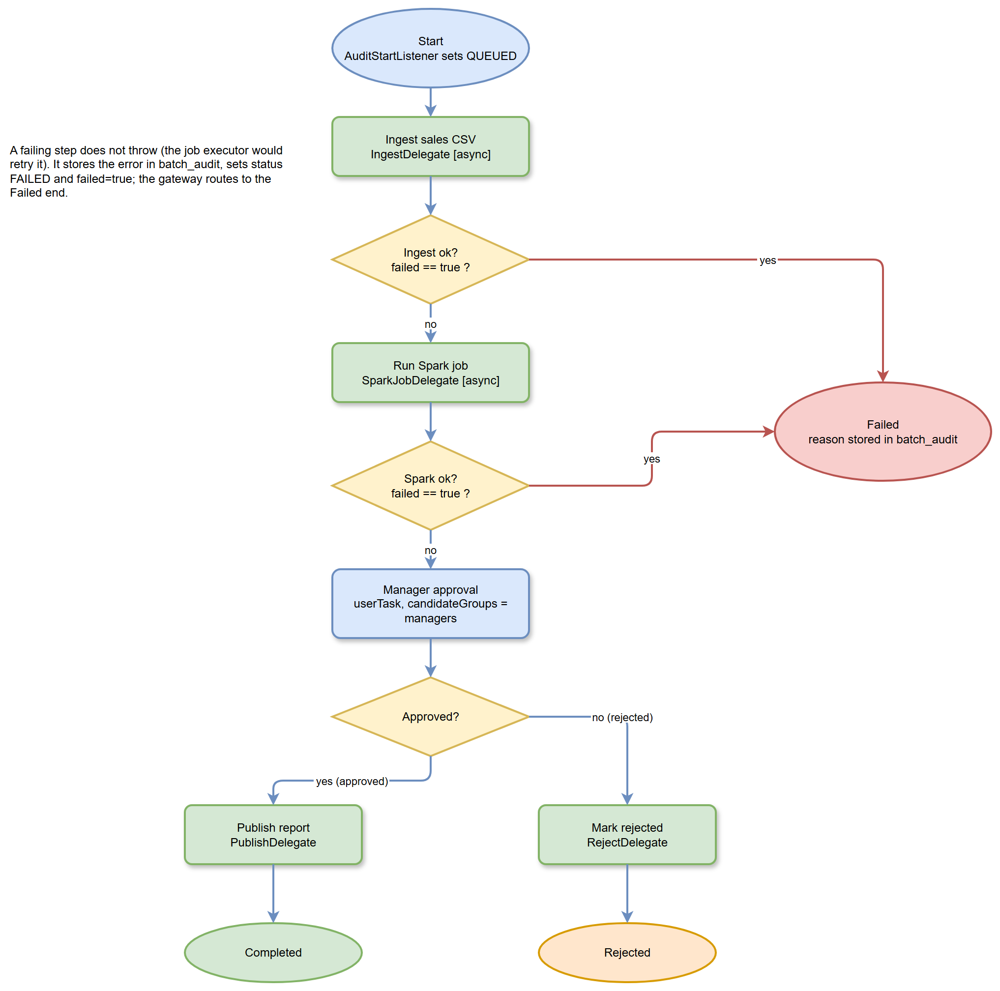
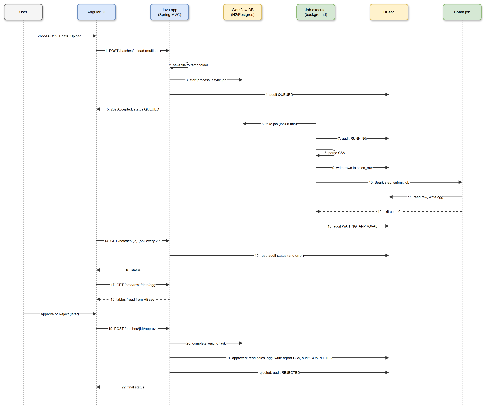
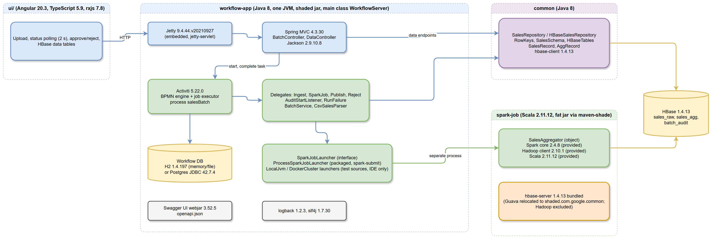
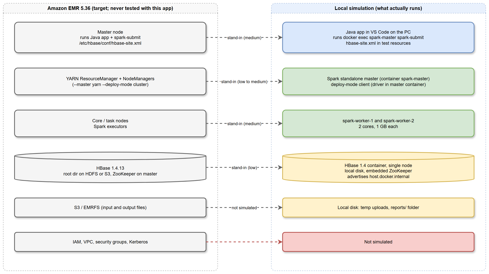

# 1. Executive Summary

Sales Batch is a workflow application. A user uploads a sales CSV in an Angular UI. A Java 8 service (Spring MVC 4.3 and Activiti 5.22 on embedded Jetty) loads the rows into HBase. A Scala 2.11 Spark 2.4.8 job then aggregates them by date, region and product. A manager approves or rejects the result, and on approval the service writes a report CSV.

The runs are asynchronous. The upload returns HTTP 202 with status `QUEUED` at once. Ingest and Spark run on Activiti job executor threads, and the UI polls for status. A failed step stores its error message and ends the run as `FAILED`.

The target platform is Amazon EMR 5.36 (Java 8, Spark 2.4.8, HBase 1.4.13, Hadoop 2.10.1, Scala 2.11.12). In practice the project has only been run locally: the Java app in VS Code on a Windows PC, HBase and an optional Spark standalone cluster (1 master, 2 workers) in Docker, and the workflow database in H2 or Postgres. **Behaviour on EMR and YARN has never been tested.**

This document is based on `latest-ARCHITECTURE.md` (the most current description in the repository) and was checked against the poms, the BPMN file, the controllers, the Spark job, `docker/local/docker-compose.yml` and `.vscode/launch.json`. `Large-App-ARCHITECTURE.md` is a reference design for large datasets. It is not implemented in this repository.

# 2. Architecture Overview



The diagram shows the local topology used for development and debugging.

| Piece | Where | Detail |
|---|---|---|
| Browser and `ng serve` | Windows host, port 4300 | Angular 20 dev server with a proxy for `/batches` and `/data` to the Java app (`ui/proxy.conf.json`). Port 4300 is used because 4200 is often taken. |
| Java app | Windows host, port 8081 | `LocalDebugServer` (test sources) started from VS Code on JDK 8. It runs Jetty, Spring MVC and Activiti in one JVM. |
| Spark child JVM | Windows host | Default mode `local-jvm`: the app starts a child JVM with `spark.master=local[*]`. Debug port 5006. |
| HBase 1.4 | Docker container `sales-hbase` | Image `harisekhon/hbase:1.4`. Ports 2181, 16000, 16020, UI 16011 on the host. It advertises `host.docker.internal`, so the IDE and the Spark containers use the same HBase. |
| Spark master and 2 workers | Docker, image `salesbatch-runtime` | Spark 2.4.8. Mode `docker-cluster`: the app runs `docker exec spark-master spark-submit` in client deploy mode, so the driver runs in the master container and the executors run on the workers (2 cores, 1 GB each). Master UI on 8090. |
| Postgres 17 | Existing Docker container, port 5432 | Optional workflow database `salesbatch_activiti`. It is not part of the compose file. |
| H2 | In the Java app | Default workflow database: memory, or the file `./data/activiti` in the debug server. |

Local-only details: `host.docker.internal`, the published ports and the `docker exec` call exist only so that an app on a Windows PC can reach the containers. They would not exist on EMR.

# 3. Processing Pipeline

## 3.1 The workflow (BPMN)



The process `salesBatch` is defined in `workflow-app/src/main/resources/processes/sales-batch.bpmn20.xml`.

1. **Start.** An execution listener (`AuditStartListener`) runs inside the start request and sets the status `QUEUED` in `batch_audit`.
2. **Ingest sales CSV** (`ingestDelegate`, `activiti:async="true"`). Runs on the job executor. It parses the CSV and writes `sales_raw`.
3. **Ingest ok?** Gateway on the process variable `failed`. `failed == true` goes to the Failed end, `failed == false` continues.
4. **Run Spark job** (`sparkJobDelegate`, async). Launches the Spark job as a separate process.
5. **Spark ok?** Same check on `failed`.
6. **Manager approval.** A user task with `candidateGroups="managers"`. It waits until a separate approve request arrives, possibly much later.
7. **Approved?** Gateway on `approved`. `true` goes to Publish report (`publishDelegate`), then Completed. `false` goes to Mark rejected (`rejectDelegate`), then Rejected.

**Failure handling.** A failing step does not throw. Throwing would make the job executor retry a step that would only fail again, for example on a bad CSV line. Instead the step stores the reason in `batch_audit`, sets the status `FAILED` and sets `failed=true`, so the gateway routes to the Failed end (`RunFailure` helper).

## 3.2 Sequence of one run



1. The UI posts the file to `POST /batches/upload`. The app saves it to a temp folder, starts the process, saves the async ingest job and writes the audit status `QUEUED`. It returns `202 Accepted` in under a second.
2. A job executor thread takes the job (locked for 5 minutes), sets `RUNNING`, parses the CSV and writes `sales_raw`.
3. The Spark step submits the job. Spark reads `sales_raw` for the business date, groups by date, region and product, and writes `sales_agg`. A zero exit code lets the run continue and the status becomes `WAITING_APPROVAL`.
4. The UI polls `GET /batches/{id}` every 2 seconds while the status is `QUEUED` or `RUNNING`, then loads `GET /data/raw` and `GET /data/agg` for the data tables.
5. The user approves or rejects with `POST /batches/{id}/approve`. On approval the app reads `sales_agg`, writes `report-yyyyMMdd.csv` and sets `COMPLETED`. On rejection it sets `REJECTED`.

## 3.3 Run states

`QUEUED` (upload accepted) -> `RUNNING` (ingest started) -> `WAITING_APPROVAL` (ingest and Spark succeeded) -> `COMPLETED` or `REJECTED`. From `RUNNING`, a bad CSV or a failed Spark job leads to `FAILED`. `GET /batches/{id}` includes an `error` field for failed runs. Approving a run that is not `WAITING_APPROVAL` returns HTTP 409.

# 4. Core Components



## 4.1 Modules

| Module | Language | Role |
|---|---|---|
| `common` | Java 8 | HBase access layer: `SalesRepository` (interface), `HBaseSalesRepository`, `HBaseTables`, `RowKeys`, `SalesSchema`, `SalesRecord`, `AggRecord`. |
| `spark-job` | Scala 2.11.12 | `SalesAggregator` (object). Fat jar built with maven-shade. Uses `reduceByKey` to aggregate. |
| `workflow-app` | Java 8 | REST API, Activiti process, delegates, Spark launchers. Shaded jar with main class `WorkflowServer`. |
| `ui` | TypeScript | Angular 20 UI: upload, status polling, approve/reject, HBase data tables. |
| `docker/` | | `Dockerfile` for the `salesbatch-runtime` image (Temurin 8 JRE, Spark 2.4.8 for Hadoop 2.7) and the `docker/local` compose stack. |

## 4.2 workflow-app classes

| Area | Classes (package `com.example.salesbatch.workflow`) |
|---|---|
| Web | `web.BatchController` (`/batches`), `web.DataController` (`/data`) |
| Config | `config.AppConfig`, `EngineConfig`, `InfraConfig`, `WebConfig` |
| Delegates | `delegate.AuditStartListener`, `IngestDelegate`, `SparkJobDelegate`, `PublishDelegate`, `RejectDelegate`, `RunFailure` |
| Services | `service.BatchService`, `service.CsvSalesParser` |
| Spark launching | `spark.SparkJobLauncher` (interface), `spark.ProcessSparkJobLauncher` (packaged: runs `spark-submit`, fails the step on a non-zero exit code) |
| IDE only (test sources) | `LocalDebugServer`, `LocalJvmSparkJobLauncher`, `DockerClusterSparkJobLauncher`, `InMemorySalesRepository` |

The IDE launchers live in the test sources and are not part of the packaged app.

## 4.3 Spark modes

| Mode | How it runs | Use |
|---|---|---|
| `local-jvm` (default) | Child JVM with `local[*]` | Stepping through all Scala code, including code inside Spark tasks. |
| `docker-cluster` (`-Dspark.mode=docker-cluster`) | `docker exec spark-master spark-submit`, client deploy mode. Driver in the master container, executors on the two workers. | Testing real distribution: serialization, jar shipping. Breakpoints inside tasks do not hit. |
| `spark-submit` on EMR | `ProcessSparkJobLauncher` in the packaged app, master `yarn`, deploy mode `cluster` | Production-like. **Never tested.** |

# 5. API Contracts and Data

## 5.1 REST API

Swagger UI is served at `http://localhost:8081/` (spec: `workflow-app/src/main/resources/swagger/openapi.json`).

| Call | Purpose | Responses |
|---|---|---|
| `POST /batches` body `{"csvPath","businessDate"}` | Start a run from a file path on the server | 202 `QUEUED`, 400 bad date |
| `POST /batches/upload` multipart `file`, `businessDate` | Start a run from an uploaded file (used by the UI) | 202 `QUEUED`, 400 bad date or empty file |
| `GET /batches/{id}` | Status (poll this) | 200 status (with `error` if `FAILED`), 404 unknown |
| `POST /batches/{id}/approve?approved=true&approver=alice` | Approve or reject | 200 new status, 409 not waiting for approval |
| `GET /data/raw?date=yyyyMMdd` | Uploaded rows from HBase | 200 list, 400 bad date |
| `GET /data/agg?date=yyyyMMdd` | Spark aggregates from HBase | 200 list, 400 bad date |

## 5.2 HBase tables

| Table | Row key | Written by | Content |
|---|---|---|---|
| `sales_raw` | `<salt 0-9>_<yyyyMMdd>_<orderId>` | Ingest step | One row per CSV line (product, region, qty, amount, timestamp) |
| `sales_agg` | `<yyyyMMdd>_<region>_<productId>` | Spark job | totalQty, totalAmount, orderCount |
| `batch_audit` | processInstanceId | Every step | status, startedAt, finishedAt, approver, error |

## 5.3 Spark job input

`SalesAggregator` is started as `spark-submit --class com.example.salesbatch.spark.SalesAggregator spark-job.jar yyyyMMdd`. It reads `sales_raw` for that date, aggregates into `Agg(totalQty, totalAmount, orderCount)` per (date, region, productId) and writes `sales_agg`.

# 6. Infrastructure and Deployment

## 6.1 Local Docker stack

`docker/local/docker-compose.yml` (project name `salesbatch-local`) defines four services: `hbase` (`harisekhon/hbase:1.4`, container `sales-hbase`), `spark-master`, `spark-worker-1` and `spark-worker-2` (image `salesbatch-runtime`, built once with `docker build -t salesbatch-runtime docker`). The project folder is mounted at `/work` so the Spark jar is read from `spark-job/target/`. Start with `docker compose -f docker/local/docker-compose.yml up -d`. `docker compose down` deletes the HBase data; `stop` keeps it.

| Port | What |
|---|---|
| 4300 | Angular dev server |
| 8081 | Java app (REST and Swagger) |
| 2181, 16000, 16020 | HBase ZooKeeper, master, region server |
| 16011 | HBase web UI (container 16010) |
| 8090 / 7077 | Spark master UI / cluster port |
| 8091, 8092 | Spark worker UIs |
| 5006 | JDWP port of the Spark driver (local child JVM or the `spark-master` container) |
| 5432 | Postgres |

## 6.2 Configuration

JVM options (`-Dname=value`) in the launch configs. Packaged defaults are in `workflow-app/src/main/resources/application.properties` (`server.port=8080`, `spark.master=yarn`, `spark.deploy.mode=cluster`, `spark.hbase.site=/etc/hbase/conf/hbase-site.xml`, `report.dir=/tmp/sales-batch-reports`).

| Property | Default | Meaning |
|---|---|---|
| `server.port` | 8081 (debug server) | HTTP port |
| `report.dir` | `reports` | Folder for report CSVs |
| `spark.mode` | `local-jvm` | `local-jvm` or `docker-cluster` |
| `spark.debug.port` / `spark.debug.suspend` | off / false | JDWP port on the Spark driver, and wait for a debugger |
| `spark.docker.container` | `spark-master` | Container that runs `spark-submit` |
| `spark.docker.jar` | `/work/spark-job/target/spark-job-1.0.0-SNAPSHOT.jar` | Fat jar path in the container |
| `activiti.jdbc.url` / `.driver` | H2 memory / `org.h2.Driver` | Workflow DB. Debug server defaults to the H2 file `./data/activiti`. Use `org.postgresql.Driver` for Postgres. |
| `debug.inmemory` | false | In-memory fakes for HBase and Spark (no Docker) |
| `user.timezone` | JVM default | Set `UTC` with Postgres (Java 8 reports `Asia/Calcutta`, which Postgres 17 rejects) |

## 6.3 VS Code debugging

`.vscode/launch.json` defines six configurations, all Java ones on JDK 8: real HBase plus local Spark; the same paused for a Scala debugger on 5006; in-memory fakes without Docker; Postgres plus Docker Spark cluster; the same paused for the Scala debugger; and "Attach to Scala Spark job (5006)".

Scala debugging uses Metals and Bloop. Bloop's project files in `.bloop/` come from a Maven import and must be patched with `node scripts/fix-bloop.js` after every re-import (it removes `common` from the `spark-job` dependencies, because Bloop's compile of `common` fails with a `-release 8` flag that JDK 8 `javac` does not have). Scala 2.11.12 is no longer supported by current Metals, so editor features are limited, although the build and the debugger work. See section 14 of `latest-ARCHITECTURE.md`.

## 6.4 EMR versus the local simulation



The local setup matches EMR 5.36 software versions and its general shape. It is not an EMR emulator and nothing here has run on EMR.

| EMR piece | Local stand-in | Fidelity |
|---|---|---|
| Versions (Spark 2.4.8, HBase 1.4.13, Hadoop 2.10.1, Scala 2.11.12, Java 8) | Same versions in Maven and images | High. The Docker Spark image bundles Hadoop 2.7 libraries, EMR has 2.10. |
| Master node runs app and `spark-submit` | App in VS Code runs `docker exec spark-submit` | Medium |
| YARN | Spark standalone master and workers | Low to medium. Same application code, different scheduler. |
| Core and task nodes | Two worker containers (2 cores, 1 GB) | Medium |
| Deploy mode `cluster` (app default) | `client` (driver in the master container) | Different on purpose: `spark-submit` returns the exit code and the driver can be debugged |
| HBase on HDFS or S3 with ZooKeeper on the cluster | One HBase container, local disk | Low |
| `/etc/hbase/conf/hbase-site.xml` passed with `--files` | `workflow-app/src/test/resources/hbase-site.xml` and `docker/local/spark-hbase-site.xml` | Medium |
| Spark and Hadoop supplied by the cluster, HBase not on Spark's classpath | `provided` scope plus a fat jar bundling the HBase client | High: the same jar would go to EMR |
| S3 / EMRFS, IAM, VPC, Kerberos, EMR Steps, autoscaling, node failures | Local disk only | Not simulated |

It is good for running the same Scala job and fat jar against real HBase 1.4 and Spark 2.4.8, for exercising process boundaries (driver to executors) and for checking the launcher contract (non-zero exit code makes the run `FAILED`). It cannot tell you about YARN behaviour, sizing, HDFS or S3 behaviour, security, or failure recovery.

To move to EMR, the README describes copying the app jar and Spark fat jar to the master node, putting `/etc/hbase/conf` on the classpath and starting `WorkflowServer`. A real deployment would also need a persistent workflow database (for example Postgres or MySQL on RDS) and S3 for input and output. These steps are untested.

## 6.5 CI/CD

No CI/CD configuration was found in the repository (no `.github/workflows`, `.gitlab-ci.yml` or `Jenkinsfile`).

# 7. Extension Patterns

**Add a workflow step.** Create a delegate in `workflow-app/src/main/java/com/example/salesbatch/workflow/delegate/`, register it as a Spring bean (`config/EngineConfig.java` and `AppConfig.java` hold the wiring), and add a `serviceTask` with `activiti:delegateExpression` to `sales-batch.bpmn20.xml`. For a long-running step add `activiti:async="true"`. Follow the failure rule: record the error through `RunFailure`, set `failed=true` and do not throw.

**Add an endpoint.** Add a method in `web/BatchController.java` or `web/DataController.java`, and update `swagger/openapi.json`.

**Add an HBase column or table.** Update `common` (`SalesSchema`, `HBaseTables`, `HBaseSalesRepository`, the `SalesRepository` interface). The in-memory test repository `InMemorySalesRepository` must match.

**Change the aggregation.** Edit `spark-job/src/main/scala/com/example/salesbatch/spark/SalesAggregator.scala`. Rebuild the fat jar for the Docker cluster with `mvn -pl spark-job -am package -DskipTests`.

**Use a different Spark launch method.** Implement `SparkJobLauncher` (see `ProcessSparkJobLauncher` and the IDE launchers).

# 8. Rules, Anti-Patterns and Known Limitations

Do:
- Record failures in `batch_audit` and set `failed=true` instead of throwing from a delegate.
- Keep Spark, Hadoop and Scala as `provided` in `spark-job`, and keep the bundled hbase-server with Guava relocated.
- Rerun `node scripts/fix-bloop.js` after every Bloop import.
- Use a new business date for each test.

Do not:
- Rely on `docker compose down` if you want to keep HBase data.
- Expect breakpoints inside Spark tasks to hit in `docker-cluster` mode.

Known limitations (from `latest-ARCHITECTURE.md` section 16):
- Activiti locks a background job for 5 minutes. Pausing at a breakpoint longer than that may restart the same Ingest or Spark step.
- The Java app still parses the CSV and writes `sales_raw` itself. This does not scale to very large files.
- **Reruns of the same business date have not been verified.**
- **EMR and YARN behaviour has not been tested.** Only `local[*]` and the Docker standalone cluster have been run.
- The cluster runs the packaged jar, so Scala changes need a rebuild.
- The IDE launchers are in the test sources and not in the packaged app.

**Reference design, not implemented.** `Large-App-ARCHITECTURE.md` describes how a much larger dataset (millions to billions of rows) should be handled, for example Spark reading the file directly instead of the Java app, and orchestration options. It is a roadmap only.

# 9. Dependencies

| Dependency | Version | Module | Purpose |
|---|---|---|---|
| Angular | 20.3 (`^20.3.0`), TypeScript 5.9, rxjs 7.8 | ui | Browser UI (needs Node 20.19+) |
| Jetty | 9.4.44.v20210927 | workflow-app | Embedded web server |
| Spring MVC (webmvc, jdbc) | 4.3.30.RELEASE | workflow-app | REST endpoints, multipart upload |
| Jackson | 2.9.10.8 | workflow-app | JSON |
| Activiti (engine, spring) | 5.22.0 | workflow-app | BPMN engine, user task, job executor |
| H2 | 1.4.197 | workflow-app | Default workflow DB |
| PostgreSQL JDBC | 42.7.4 | workflow-app | Optional workflow DB |
| Swagger UI webjar | 3.52.5 | workflow-app | API docs page |
| logback, slf4j | 1.2.3, 1.7.30 | workflow-app | Logging |
| hbase-client | 1.4.13 | common | HBase access |
| Spark core | 2.4.8 (provided) | spark-job | Aggregation |
| Hadoop client | 2.10.1 (provided) | spark-job | Cluster supplies it |
| Scala | 2.11.12 (provided) | spark-job | Job language |
| hbase-server | 1.4.13 (bundled, Guava relocated to `shaded.com.google.common`) | spark-job | HBase input format; EMR does not put HBase on Spark's classpath |
| JUnit | 4.13.2 | tests | Testing |
| Maven plugins | compiler 3.8.1, surefire 2.22.2, shade 3.2.4, scala-maven-plugin 4.8.1 | build | Build |
| HBase container | `harisekhon/hbase:1.4` | Docker | Storage |
| Spark standalone | 2.4.8 (`salesbatch-runtime`) | Docker | Optional cluster |
| PostgreSQL | 17 (existing container) | Docker | Optional workflow DB |

# 10. Code Structure

```
sales-batch-parent/
  pom.xml                       parent POM (Java 1.8, versions pinned to EMR 5.36)
  latest-ARCHITECTURE.md        most current architecture (authoritative)
  ARCHITECTURE.md               older, shorter introduction
  Large-App-ARCHITECTURE.md     reference design for large data (not implemented)
  README.md                     setup, run, debug, troubleshooting
  common/                       HBase access layer
    src/main/java/.../common/   SalesRepository, HBaseSalesRepository, HBaseTables,
                                RowKeys, SalesSchema, SalesRecord, AggRecord
  spark-job/                    Scala 2.11 Spark job (fat jar)
    src/main/scala/.../spark/   SalesAggregator.scala
  workflow-app/                 Spring MVC + Activiti on embedded Jetty
    src/main/java/.../workflow/ config/, delegate/, service/, spark/, web/, WorkflowServer
    src/main/resources/         application.properties, processes/sales-batch.bpmn20.xml,
                                swagger/ (index.html, openapi.json), logback.xml
    src/test/                   tests plus IDE-only LocalDebugServer and Spark launchers
  ui/                           Angular 20 app (src/app, proxy.conf.json)
  docker/                       Dockerfile, hbase-site.xml, local/ (compose stack, start-hbase.sh)
  sample-data/                  sales-20261113.csv, sales-20261115.csv, sales-bad.csv
  scripts/                      fix-bloop.js
  docs/                         this document and its diagrams
```

Generated or local-only folders (`target/`, `node_modules/`, `.bloop/`, `.metals/`, `data/`, `ui/dist/`, `reports/`) are not described here.
