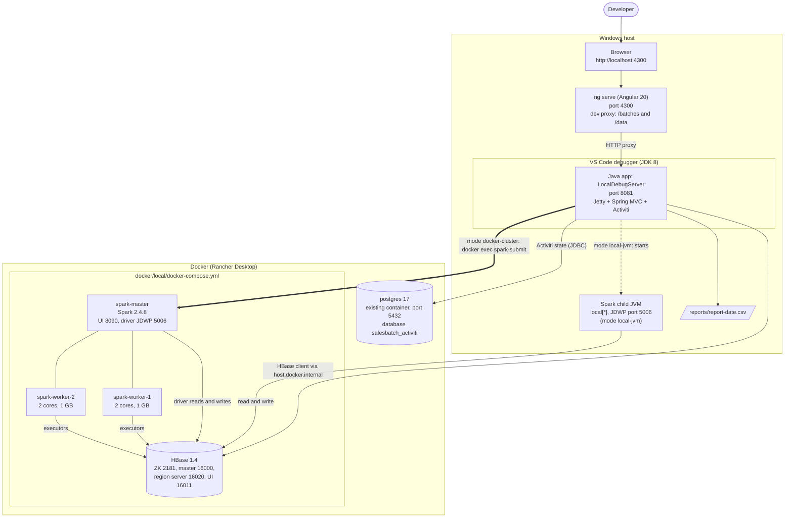
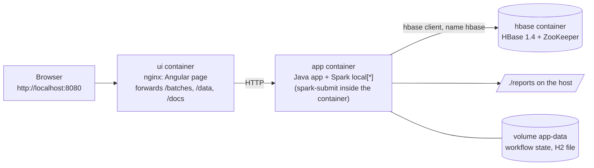
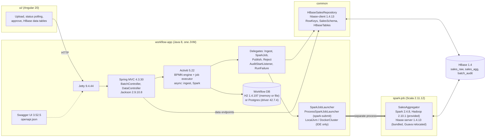
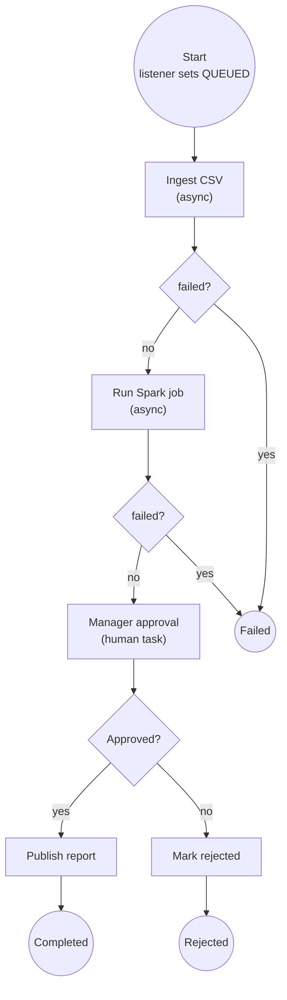
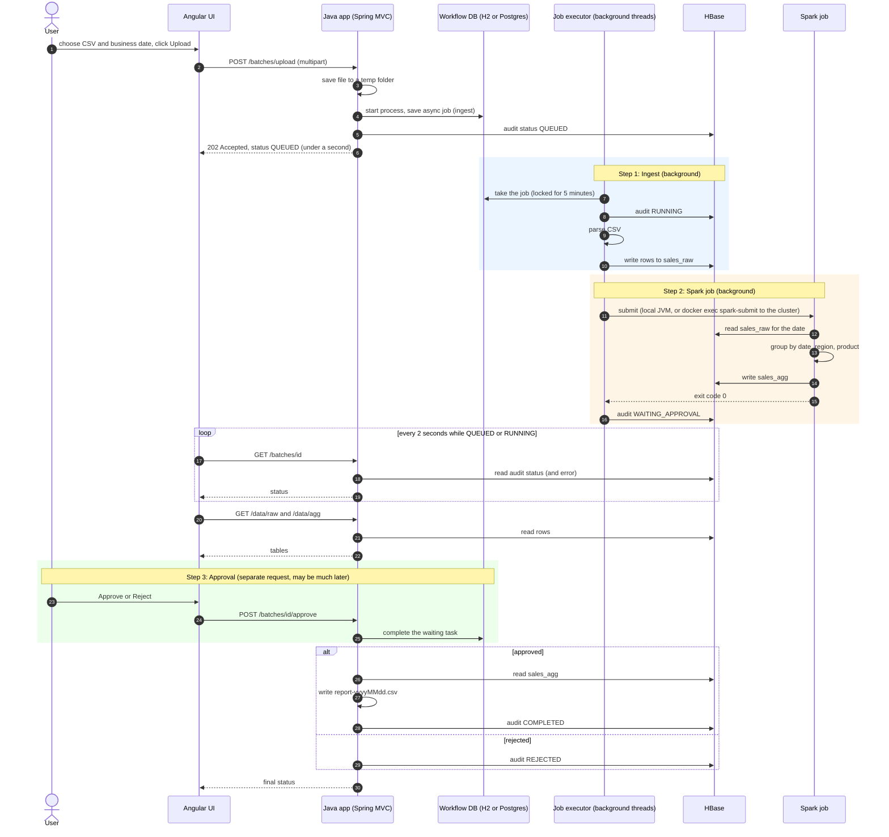
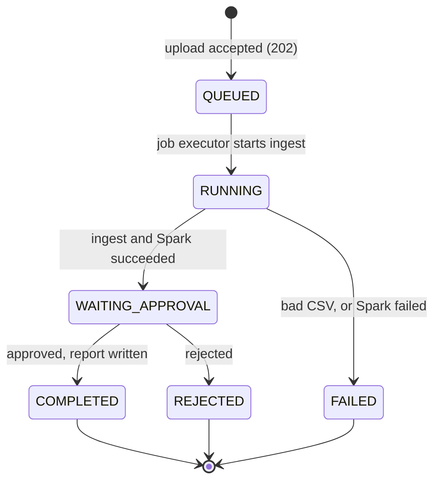
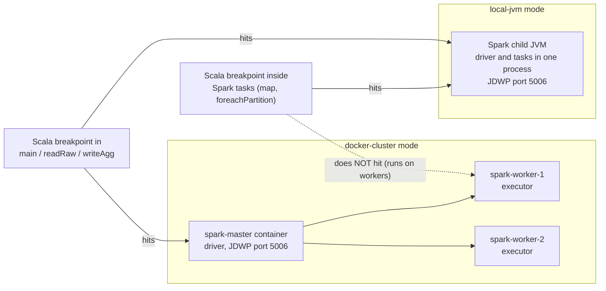
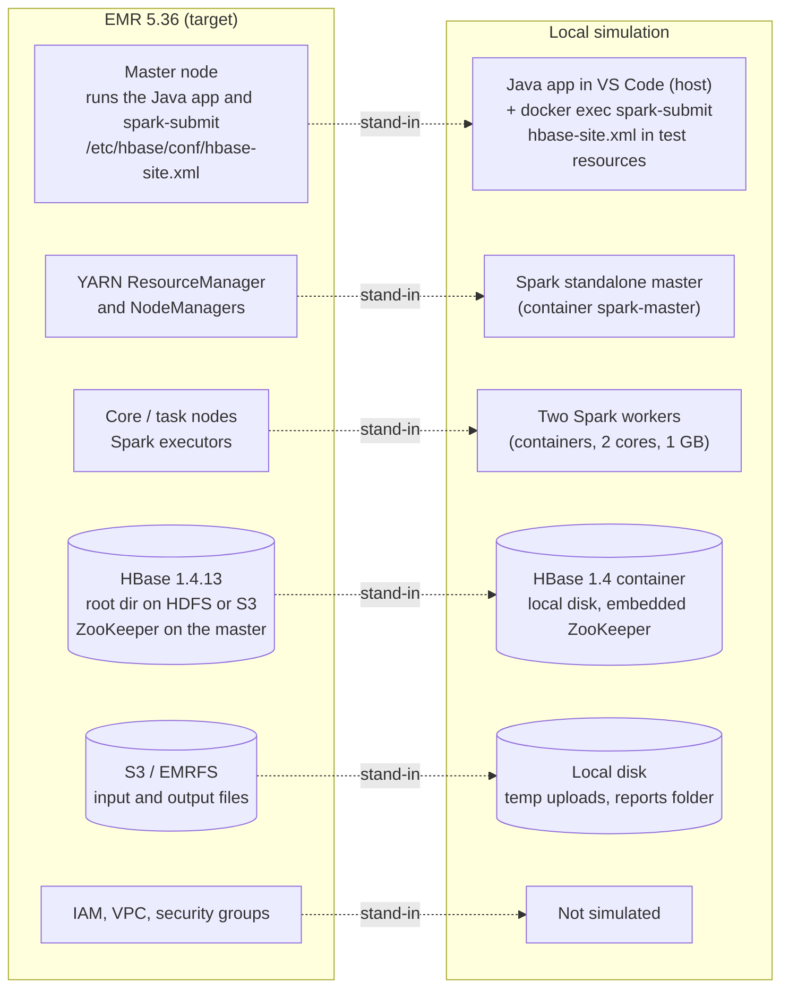
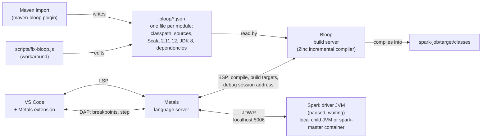
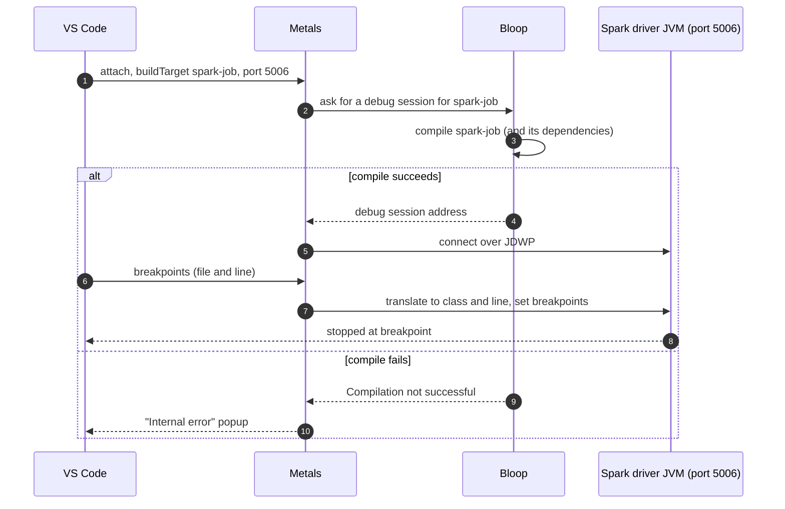

# Sales Batch: Latest Architecture (current state)

This is the up-to-date description of the app as it is built now. It replaces the older [ARCHITECTURE.md](ARCHITECTURE.md) where they differ and adds everything that was introduced later:

- asynchronous runs (the upload returns at once, the work happens in the background);
- failure handling with a stored error message;
- the Angular UI with an upload endpoint and HBase data tables;
- workflow state in H2 (memory or file) or **Postgres**;
- an optional **Spark standalone cluster in Docker** (1 master, 2 workers) next to the default local Spark;
- the VS Code debug setup for Java and Scala, and how **Metals and Bloop** make Scala breakpoints work (section 14);
- how the local setup relates to **EMR 5.36** (section 10, for reference).

For how a much larger dataset would be handled, see [Large-App-ARCHITECTURE.md](Large-App-ARCHITECTURE.md). For setup steps, see [README.md](README.md).

The diagrams are written in [Mermaid](https://mermaid.js.org/). They render on GitHub, GitLab, and in VS Code (Markdown Preview Mermaid Support extension).

## 1. What the app does

A user uploads a sales CSV. The app loads it into HBase, a Scala Spark job aggregates it (by date, region and product), a manager approves or rejects the result, and on approval a report CSV is written.

| Step | Where it runs | Result |
|---|---|---|
| Upload | Browser to the Java app | Run created, status `QUEUED` (HTTP 202) |
| Ingest | Background thread in the Java app | CSV rows written to HBase table `sales_raw` |
| Aggregate | Spark job (separate process) | Aggregates written to `sales_agg` |
| Approve or reject | A separate request, any time later | `COMPLETED` (report written) or `REJECTED` |

## 2. Local topology (what runs where)

**Hostname trick:** HBase advertises the name `host.docker.internal`. On the Windows host that name resolves to 127.0.0.1 (Docker Desktop and Rancher Desktop add it to the hosts file), and inside other containers it resolves to the host. The IDE and the Spark containers therefore use the same HBase through the same published ports, with no hosts-file change.

### Docker-only quick start (for sharing the POC)

Besides the IDE setup above, the project can be started with nothing but Docker: `docker compose up --build` in the project root ([docker-compose.yml](docker-compose.yml)). It builds the Java and Scala code, the Spark jar and the Angular UI inside Docker, so a teammate needs no JDK, Maven, Node or Spark.

| Quick start | IDE setup (docker/local) |
|---|---|
| One command, only Docker needed | JDK 8, Maven, Node, VS Code, Docker |
| Spark `local[*]` inside the app container | Spark `local[*]` child JVM, or the Docker cluster (master and 2 workers) |
| HBase reachable only inside the compose network (service name `hbase`) | HBase published on the host (advertised as `host.docker.internal`) |
| Workflow state in an H2 file in a Docker volume | H2 file, or Postgres |
| No debugging | Java and Scala breakpoints |

## 3. Components and dependencies

### Dependency table

| Dependency | Version | Module | Purpose |
|---|---|---|---|
| Angular | 20 | ui | The browser UI (needs Node 20.19+) |
| Jetty | 9.4.44 | workflow-app | Embedded web server (no Tomcat or WAR) |
| Spring MVC | 4.3.30 | workflow-app | REST endpoints, multipart upload |
| Jackson | 2.9.10.8 | workflow-app | JSON for REST |
| Activiti | 5.22.0 | workflow-app | BPMN workflow, human approval task, background job executor |
| H2 | 1.4.197 | workflow-app | Default workflow database (memory), or a file in the IDE debug server |
| PostgreSQL JDBC | 42.7.4 | workflow-app | Optional workflow database |
| Swagger UI webjar | 3.52.5 | workflow-app | API docs page |
| logback, slf4j | 1.2.3, 1.7.30 | workflow-app | Logging |
| hbase-client | 1.4.13 | common | Reads and writes the HBase tables |
| Spark core | 2.4.8 | spark-job | Aggregation. `provided`: the cluster supplies it |
| Hadoop client | 2.10.1 | spark-job | `provided` |
| Scala | 2.11.12 | spark-job | Language of the job. `provided` |
| hbase-server | 1.4.13 | spark-job | HBase input format for Spark. Bundled in the fat jar, because EMR does not put HBase on Spark's classpath |
| HBase | 1.4 (container `harisekhon/hbase:1.4`) | external | Storage for rows, aggregates, run status |
| Spark standalone | 2.4.8 (image `salesbatch-runtime`) | external (Docker) | Optional cluster: 1 master, 2 workers |
| PostgreSQL | 17 (existing container) | external (Docker) | Optional workflow database |

## 4. The workflow (BPMN)

Defined in [sales-batch.bpmn20.xml](workflow-app/src/main/resources/processes/sales-batch.bpmn20.xml). Steps marked **async** run on Activiti's job executor threads, not on the web request.

**Failure handling:** a failing step does **not** throw. It stores the reason in `batch_audit`, sets the status `FAILED`, and sets the process variable `failed=true`, so the gateway routes to the failed end. Throwing would make the job executor retry a step that would only fail again (for example a bad CSV line).

## 5. Full flow of one run

## 6. Run states

`GET /batches/{id}` returns the status, and an `error` field when the run is `FAILED` (for example `Line 3: bad number ...`). Approving a run that is not `WAITING_APPROVAL` returns HTTP 409.

## 7. REST API

| Call | Purpose | Responses |
|---|---|---|
| `POST /batches` body `{"csvPath","businessDate"}` | Start a run from a file path on the server | 202 `QUEUED`, 400 bad date |
| `POST /batches/upload` multipart `file` and `businessDate` | Start a run from an uploaded file (used by the UI) | 202 `QUEUED`, 400 bad date or empty file |
| `GET /batches/{id}` | Status (poll this) | 200 status (with `error` if `FAILED`), 404 unknown |
| `POST /batches/{id}/approve?approved=true&approver=alice` | Approve or reject | 200 new status, 409 not waiting for approval |
| `GET /data/raw?date=yyyyMMdd` | Uploaded rows read from HBase | 200 list, 400 bad date |
| `GET /data/agg?date=yyyyMMdd` | Spark aggregates read from HBase | 200 list, 400 bad date |

Swagger UI at http://localhost:8081/ (spec: [openapi.json](workflow-app/src/main/resources/swagger/openapi.json)).

## 8. Data in HBase

| Table | Row key | Written by | Content |
|---|---|---|---|
| `sales_raw` | `<salt 0-9>_<yyyyMMdd>_<orderId>` | Ingest step | One row per CSV line (product, region, qty, amount, timestamp) |
| `sales_agg` | `<yyyyMMdd>_<region>_<productId>` | Spark job | totalQty, totalAmount, orderCount |
| `batch_audit` | processInstanceId | Every step | status, startedAt, finishedAt, approver, **error** |

## 9. Spark modes

| Mode | How it runs | Use it for |
|---|---|---|
| `local-jvm` (default) | The app starts a child JVM with `spark.master=local[*]` | Stepping through all the Scala code, including code inside Spark tasks |
| `docker-cluster` (`-Dspark.mode=docker-cluster`) | The app runs `docker exec spark-master spark-submit` in client deploy mode: the **driver** runs in the master container, the **executors** on the two workers | Testing real distribution: separate processes, serialization, jar shipping |
| `spark-submit` on EMR | `ProcessSparkJobLauncher` in the packaged app (`WorkflowServer`), master `yarn` | Production-like (never tested here) |

## 10. How the local setup simulates EMR (for reference)

The target platform is **Amazon EMR 5.36**. Nothing here runs on EMR, and the EMR behaviour of this app has **never been tested**. The local Docker setup is a stand-in that matches EMR's software versions and its general shape, so the same code and the same Spark jar can be exercised, but it is not an EMR emulator.

### Mapping: EMR piece and its local stand-in

| EMR piece | Local stand-in | How faithful |
|---|---|---|
| **Software versions**: Spark 2.4.8, HBase 1.4.13, Hadoop 2.10.1, Scala 2.11.12, Java 8 | The same versions in the Maven build and in the HBase and Spark images | **High** for the app and job code. One small difference: the Docker Spark image bundles Hadoop 2.7 libraries, while EMR has Hadoop 2.10 |
| **Master node** runs the app and calls `spark-submit` | The app runs in VS Code on your PC and runs `docker exec spark-master spark-submit` | **Medium**: same roles, different place |
| **YARN** schedules containers on the nodes | A Spark **standalone** master and workers | **Low to medium**: the Spark application code is identical, but the scheduler is different (see below) |
| **Core and task nodes** run executors | Containers `spark-worker-1` and `spark-worker-2` (2 cores and 1 GB each) | **Medium**: real separate executor processes, but tiny and on one machine |
| **Deploy mode**: the app defaults to `--master yarn --deploy-mode cluster` (driver on the cluster) | `--deploy-mode client` (driver in the `spark-master` container) | **Different on purpose**: client mode lets `spark-submit` return the job's exit code and lets you attach a debugger to the driver |
| **HBase** with its data on HDFS or S3, on the cluster, with ZooKeeper | One HBase container, data on the container disk, embedded ZooKeeper | **Low**: same client API and tables, but a single node, no HDFS or S3, no region server distribution, no high availability |
| **`/etc/hbase/conf/hbase-site.xml`** on the master, passed to Spark with `--files` | `workflow-app/src/test/resources/hbase-site.xml` for the app, and `spark-hbase-site.xml` mounted into the Spark containers | **Medium**: same mechanism, different files |
| **Spark and Hadoop jars supplied by the cluster; HBase is NOT on Spark's classpath** | `provided` scope plus a **fat jar** that bundles the HBase client (Guava relocated) | **High**: the same jar is what you would copy to EMR |
| **S3 / EMRFS** for input and output | Local disk: a temp folder for uploads and the `reports/` folder | **Not simulated** |
| **IAM, VPC, security groups, Kerberos** | None | **Not simulated** |
| **EMR Steps, Livy, Zeppelin, Ganglia, CloudWatch** | The Spark master web UI (port 8090) | **Partial**: you can see applications and executors, nothing more |
| **Autoscaling, spot interruptions, node failures** | None | **Not simulated** |
| **Scale**: many nodes with many cores and gigabytes | Your PC's CPUs and RAM, shared with everything else | **Not comparable** |

### What the simulation is good for
- Running the **same Scala job and the same fat jar** as EMR, against a real HBase 1.4 and real Spark 2.4.8.
- Seeing the code and data **cross real process boundaries** (driver to executors), which `local[*]` hides: serialization errors, missing classes in the jar, and configuration that only exists on the driver.
- Checking that the **launcher contract holds**: `spark-submit` blocks until the job ends, and a non-zero exit code makes the run `FAILED`.

### What it cannot tell you
- **YARN behaviour**: queues, container memory limits and overhead, container kills, and how the driver is placed in `cluster` deploy mode.
- **Performance and sizing**: how many nodes, how much memory, how long a real dataset takes.
- **Storage behaviour**: HDFS or S3 latency, S3 consistency, HBase region splits and hotspots under real load.
- **Security and networking**: IAM permissions, subnets, security group rules, Kerberos.
- **Failure behaviour**: lost nodes, spot reclaims, retries by YARN.

### The `host.docker.internal` hostname is a local-only trick
On EMR, HBase clients find the master and region servers through ZooKeeper and normal cluster DNS, and the app reads `/etc/hbase/conf` on the master node. The `host.docker.internal` name, the published ports and the `docker exec` call exist only so that an app on your Windows PC can reach containers. They would all disappear on EMR.

### What the move to EMR would involve
The README ("Run on the EMR master node") already describes the shape: copy the app jar and the Spark fat jar to the master node, put `/etc/hbase/conf` on the classpath, and start the packaged `WorkflowServer`. The defaults in `application.properties` (`spark.master=yarn`, `spark.deploy.mode=cluster`, `spark.hbase.site=/etc/hbase/conf/hbase-site.xml`) are written for that case. Beyond that, a real deployment would also need:
- a persistent workflow database (Postgres or MySQL, for example RDS) instead of the in-memory H2 default;
- input and output in S3 instead of local disk;
- the points in [Large-App-ARCHITECTURE.md](Large-App-ARCHITECTURE.md) if the data is large.

## 11. Configuration reference

These are JVM options (`-Dname=value`) in the `vmArgs` of the launch configs.

| Property | Default | Meaning |
|---|---|---|
| `server.port` | 8081 (debug server) | HTTP port of the Java app |
| `report.dir` | `reports` | Folder where report CSVs are written |
| `spark.mode` | `local-jvm` | `local-jvm` or `docker-cluster` |
| `spark.debug.port` | off | Opens a JDWP port on the Spark driver (use 5006) |
| `spark.debug.suspend` | false | If true, the Spark driver waits for a debugger to attach |
| `spark.docker.container` | `spark-master` | Container that runs `spark-submit` |
| `spark.docker.jar` | `/work/spark-job/target/spark-job-1.0.0-SNAPSHOT.jar` | Fat jar path inside the container |
| `spark.local.classpath.file` | `spark-job/target/local-classpath.txt` | Classpath of the local Spark JVM (built with Maven) |
| `activiti.jdbc.url` | `jdbc:h2:mem:activiti;DB_CLOSE_DELAY=-1` | Workflow database. The debug server defaults to the H2 file `./data/activiti` |
| `activiti.jdbc.driver` | `org.h2.Driver` | Use `org.postgresql.Driver` for Postgres |
| `activiti.jdbc.username`, `activiti.jdbc.password` | `sa`, empty | Database credentials |
| `debug.inmemory` | false | Use in-memory fakes for HBase and Spark (no Docker) |
| `user.timezone` | JVM default | Set to `UTC` with Postgres: Java 8 reports `Asia/Calcutta`, which Postgres 17 rejects |

## 12. Ports

| Port | What |
|---|---|
| 4300 | Angular dev server (4200 is often used by another project) |
| 8081 | Java app (REST and Swagger) |
| 2181, 16000, 16020 | HBase: ZooKeeper, master, region server |
| 16011 | HBase web UI |
| 8090 | Spark master web UI |
| 7077 | Spark master (cluster port) |
| 8091, 8092 | Spark worker web UIs |
| 5006 | JDWP debug port of the Spark driver (local child JVM, or the `spark-master` container) |
| 5432 | Postgres |

## 13. VS Code debug setup

Defined in [.vscode/launch.json](.vscode/launch.json). All Java configs run on JDK 8 (`javaExec`) with `console: internalConsole`.

| Launch config | Spark | Workflow DB | Use |
|---|---|---|---|
| Debug app (real HBase + Scala Spark job) | local JVM | H2 file | Java breakpoints |
| Debug app + wait for Scala debugger on 5006 | local JVM, paused | H2 file | Java and Scala breakpoints |
| Debug app (in-memory fakes, no Docker) | fake | H2 memory | Quick check, no Docker |
| Debug app (Postgres + Docker Spark cluster) | Docker cluster | Postgres | Realistic run |
| Debug app (Postgres + Docker Spark cluster) + wait for Scala debugger on 5006 | Docker cluster, driver paused | Postgres | Scala driver breakpoints |
| Attach to Scala Spark job (5006) | (attach) | | Attach the Scala (Metals) debugger to the paused driver |

Start the Docker stack with `docker compose -f docker/local/docker-compose.yml up -d`. The Scala debugger needs the Metals and Bloop build set up (`node scripts/fix-bloop.js`); see section 14 and the README.

## 14. Scala debugging toolchain: Metals and Bloop

Debugging the Scala Spark job in VS Code involves two programs that are easy to confuse. This section explains what each does, how they work together in this project, and the one workaround the project needs.

### Roles

| Program | Job | In this project |
|---|---|---|
| **Metals** | Scala language server: code completion, go-to-definition, and the debugger for `.scala` files in VS Code | The *Scala (Metals)* extension |
| **Bloop** | Build server: compiles the code and tells Metals what the project looks like | Started by Metals on demand |
| **Maven** | The real build tool of the project | Used once to generate Bloop's project files (the "import") |

Metals never compiles anything itself. It asks Bloop, using the Build Server Protocol (BSP).

### Files

| Path | What it is |
|---|---|
| `.bloop/*.json` | One file per module (`spark-job.json`, `common.json`, and `-test` variants): source folders, the full classpath, Scala version, JDK, and which other modules it depends on. Generated, not hand-written |
| `.metals/` | Metals' cache, index and log (`metals.log`). The log is the first place to look when something fails |
| `.vscode/settings.json` | `metals.javaHome` (the Java that runs Metals and Bloop) and `debug.allowBreakpointsEverywhere` |
| `.vscode/launch.json` | The `scala` attach config. Its `buildTarget: "spark-job"` names a project in `.bloop/` |
| `scripts/fix-bloop.js` | Removes the broken dependency from `.bloop/spark-job.json` (see below) |

### What happens when you press "Attach to Scala Spark job (5006)"

### The two JVMs

- **Metals and Bloop** run on the newer Java bundled with the Red Hat Java extension (`metals.javaHome`), because Metals itself needs Java 17 or newer.
- **The project** is still compiled and run for **JDK 8**: `.bloop/spark-job.json` records the JDK 8 home, and the app and the Spark job run on JDK 8.

### The workaround: `scripts/fix-bloop.js`

- **Problem.** Bloop sees `spark-job` depending on the Java module `common`, so it compiles `common` first. That compile is given a `-release 8` flag that JDK 8's `javac` does not have (`bad option: '-release'`). It fails, everything after it is blocked, and the attach reports `Compilation not successful`.
- **Fix.** The script removes `common` from the dependencies of `spark-job` in `.bloop/`. `common` is already built by Maven and `common/target/classes` is on the `spark-job` classpath, so Bloop now only compiles the Scala code.
- **A second fix is in the POMs.** HBase pulls in a `jdk.tools` dependency that the Bloop Maven plugin cannot resolve. It is excluded in `common/pom.xml` and `spark-job/pom.xml`. Without that, the Bloop import itself fails.
- **Re-importing overwrites `.bloop/`**, so rerun the script after every import.

### Behaviours to know

- **Shared output folder.** Bloop writes into the same `spark-job/target/classes` that Maven uses, so the two builds overwrite each other's class files. The Docker cluster mode uses the Maven fat jar, not that folder.
- **Old Scala version.** Scala 2.11.12 is no longer supported by current Metals. The Metals log says it falls back to an older presentation compiler, so editor features such as completion may be limited. The build itself (Bloop compiling with 2.11.12) works.
- **Breakpoint limits.** Metals attaches to one JVM. In `local-jvm` mode that JVM runs the driver and the tasks. In `docker-cluster` mode it is only the driver, so code inside Spark tasks (the `map` and `foreachPartition` bodies) does not hit. See section 9.

### When to redo what

| Situation | What to do |
|---|---|
| Changed Scala code | Nothing for Bloop. Rebuild the jar if you use the Docker cluster |
| Changed `pom.xml` dependencies | Re-import (the Maven plugin command in the README), then rerun `node scripts/fix-bloop.js` |
| Attach says "Internal error" or `Compilation not successful` | Run the script, then **Metals: Restart build server** |
| `no build target found` in `.metals/metals.log` | `.bloop/` is missing: the import has not run |
| Breakpoints are grey | Same as above, or the attach has not happened yet |

## 15. What changed since ARCHITECTURE.md

| Before | Now |
|---|---|
| Upload request blocked until Spark finished | Upload returns `202 QUEUED`; Ingest and Spark run in the background; the UI polls |
| Activiti state only in memory | H2 memory, H2 file, or Postgres |
| Errors threw exceptions inside the request | Errors are stored in `batch_audit` and returned by `GET /batches/{id}` |
| Spark only as a local child JVM | Also a Docker standalone cluster (1 master, 2 workers) |
| No UI | Angular UI with upload, status, approval and HBase data tables |
| HBase advertised `localhost` | HBase advertises `host.docker.internal`, so the IDE and the containers share it |
| Statuses `RUNNING`, `WAITING_APPROVAL`, `COMPLETED`, `REJECTED`, `FAILED` | Adds `QUEUED` |

## 16. Known limitations

- **Debug pauses and the job lock.** Activiti locks a background job for 5 minutes by default. Sitting at a breakpoint longer than that may let the engine start the same Ingest or Spark step again.
- **Breakpoints inside Spark tasks** only work in `local-jvm` mode. In `docker-cluster` mode that code runs on the workers.
- **Scala breakpoints depend on a workaround.** The Bloop import must be patched with `node scripts/fix-bloop.js` after every re-import (section 14). Scala 2.11.12 is no longer supported by current Metals, so editor features are limited, although the build and the debugger work.
- **Fat jar for the cluster.** The cluster runs the packaged jar. After Scala changes run `mvn -pl spark-job -am package -DskipTests`.
- **The Java app still parses the CSV and writes `sales_raw` itself.** That does not scale to very large files; Spark should read the file directly (see the large-app document).
- **Reruns of the same business date** have not been verified. Use a new date for each test.
- **`docker compose down` deletes the HBase data.** `docker compose stop` keeps it.
- **EMR and YARN** behaviour has not been tested. Only `local[*]` and the Docker standalone cluster have been run.
- **The IDE launchers** (`LocalJvmSparkJobLauncher`, `DockerClusterSparkJobLauncher`, `LocalDebugServer`) live in the test sources and are not part of the packaged app.
